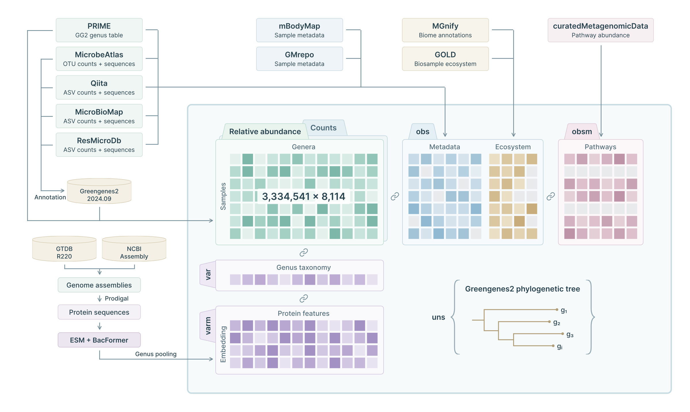
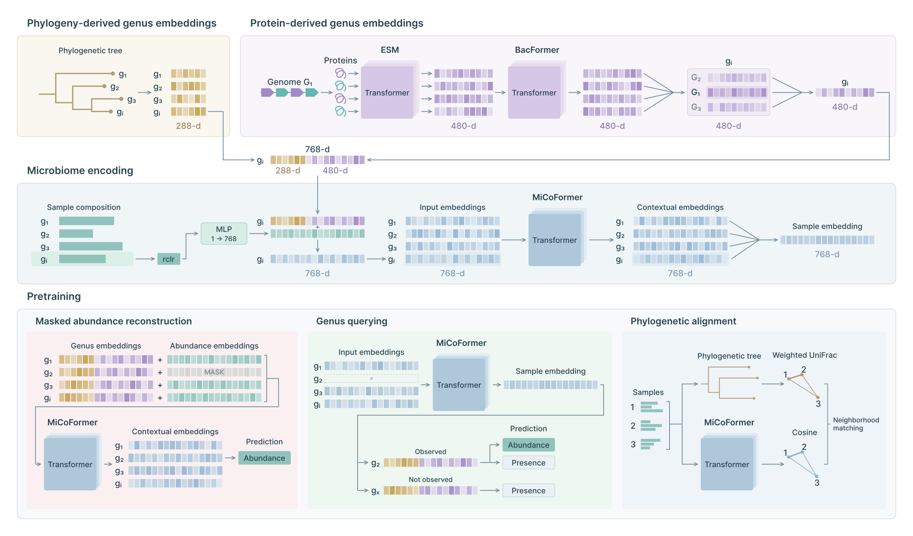

  

  
  
  

  
  
  

## MCFCorpus

We integrated data from 10 databases, including MicrobeAtlas, Qiita, MicroBioMap, PRIME, and ResMicroDb, and reannotated sequence data against Greengenes2. The AnnData object contains genus-level profiles for 3,334,541 samples across 8,114 genera.

## Model architecture

Each genus prior combines a phylogenetic embedding from the reference tree with a protein-derived embedding generated using ESM-2 and BacFormer and aggregated across genomes.

MiCoFormer embeds rclr-transformed abundances and adds them to genus priors for Transformer encoding. Pretraining combines masked abundance reconstruction, held-out genus presence and abundance prediction, and UniFrac-based neighborhood matching.

